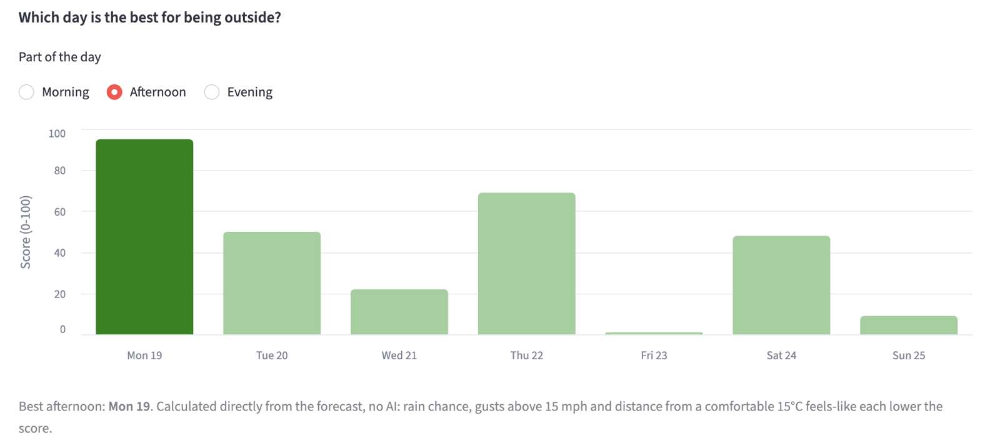
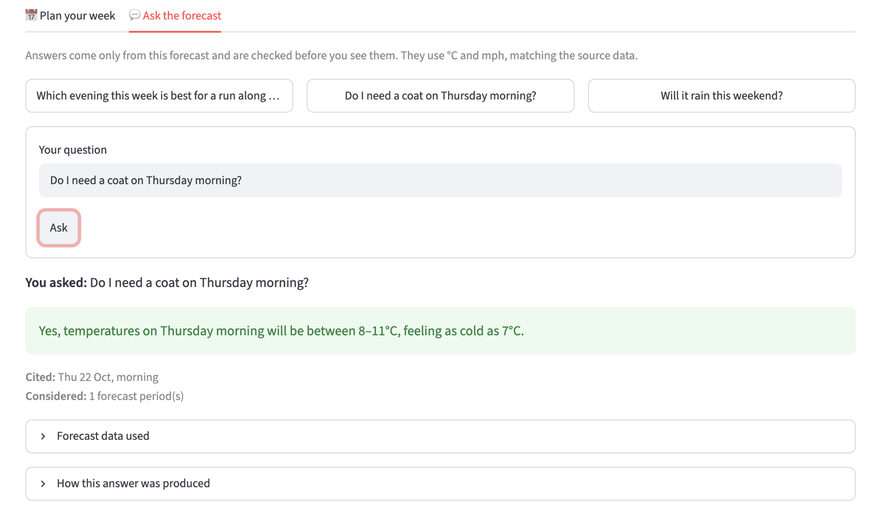
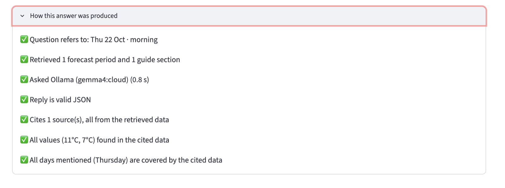

# London Weather · 7-day forecast with grounded Q&A

A small Streamlit app that fetches the 7-day London forecast and lets you explore it two ways:

- **Plan your week:** day cards plus three planning charts (rain by hour, which day is best for being outside, and temperature vs feels-like with wind).
- **Ask the forecast:** plain-English questions answered by an LLM, grounded in retrieved forecast data, with the sources shown and every answer checked before you see it. The model runs locally or through an API, switched by one setting.

The forecast view never depends on the LLM. If the model is unavailable, slow or returns something unusable, you get the relevant forecast data instead.

## Screenshots

### Plan your week



### Ask the forecast





---

## Quick start

**You need:** Python 3.11+ and a free [Visual Crossing](https://www.visualcrossing.com/) API key.
**For AI answers (optional):** [Ollama](https://ollama.com/), or a free ollama.com account. Without a model the app still works fully: forecast, charts, and Q&A fall back to showing the retrieved forecast data.

### Run locally

**1. Clone and install**

```bash
git clone https://github.com/gumienniczak/london_weather_rag.git && cd london_weather_rag
bash setup.sh        # creates .venv, installs dependencies, creates .env from .env.example
```

**2. Add your weather key.** Open `.env` and paste your key after `VISUAL_CROSSING_API_KEY=`.

**3. Pick a model** (edit the same `.env`; skip this to use the default local model):

| Option                        | What to do first                                                    | Set in `.env`                                                                            |
| ----------------------------- | ------------------------------------------------------------------- | ---------------------------------------------------------------------------------------- |
| Local model (default)         | Install Ollama, then `ollama pull gemma4:12b`                       | nothing, already set                                                                     |
| Cloud model via Ollama        | Install Ollama, then `ollama signin` and `ollama pull gemma4:cloud` | `OLLAMA_MODEL=gemma4:cloud`                                                              |
| Ollama API, nothing installed | Create a key at ollama.com/settings/keys                            | `OLLAMA_HOST=https://ollama.com`, `OLLAMA_MODEL=gemma4:31b`, `OLLAMA_API_KEY=<your key>` |

Ollama must be running (the desktop app, or `ollama serve`) for the first two options.

**4. Run**

```bash
source .venv/bin/activate
streamlit run app.py
```

Then open http://localhost:8501.

### Run with Docker

Keys are passed at run time, never built into the image. From the cloned folder:

**1.** Create `.env` and add your keys (steps 2–3 above):

```bash
cp -n .env.example .env        # keeps your .env if it already exists
```

**2.** Build and run:

```bash
docker build -t london-weather .
```

If you use **Ollama on your machine** (local or cloud model):

```bash
docker run --rm -p 8501:8501 --env-file .env \
  -e OLLAMA_HOST=http://host.docker.internal:11434 \
  --add-host=host.docker.internal:host-gateway \
  london-weather
```

If you use **the Ollama API directly**:

```bash
docker run --rm -p 8501:8501 --env-file .env london-weather
```

Then open http://localhost:8501.

### Choosing the model (local vs API)

The same code (`OllamaProvider`) runs all three setups; only `.env` changes.

| Setup                      | Settings                                                                        | Answer time\* |
| -------------------------- | ------------------------------------------------------------------------------- | ------------- |
| **Local model**            | `ollama pull gemma4:12b`, then `OLLAMA_MODEL=gemma4:12b`                        | ~22 s         |
| **Cloud via local Ollama** | `ollama signin`, then `OLLAMA_MODEL=gemma4:cloud`                               | ~0.5 s        |
| **Cloud API, no install**  | `OLLAMA_HOST=https://ollama.com`, `OLLAMA_MODEL=gemma4:31b`, `OLLAMA_API_KEY=…` | ~0.8 s        |

\*One question, measured on my Mac. On a slower machine, use a smaller local model (gemma4:e4b) or adjust LLM_TIMEOUT_SECONDS.

Both cloud setups need a free [ollama.com](https://ollama.com) account. For **cloud via local Ollama**, install Ollama and run `ollama signin` once; the app needs no key. For **cloud API, no install**, create a key at ollama.com/settings/keys and put it in `.env` as `OLLAMA_API_KEY`.

Try a question from the command line, without the UI:

```bash
python scripts/ask.py --fixture tests/fixtures/valid.json "Which evening this week is best for a run?"
```

### Configuration

All settings come from environment variables (see `.env.example`). Nothing secret is in the code or the repo.

| Variable                  | Default                  | Purpose                                            |
| ------------------------- | ------------------------ | -------------------------------------------------- |
| `VISUAL_CROSSING_API_KEY` | (required)               | Weather data                                       |
| `OLLAMA_HOST`             | `http://localhost:11434` | Ollama server (local or `https://ollama.com`)      |
| `OLLAMA_MODEL`            | `gemma4:12b`             | Model tag                                          |
| `OLLAMA_API_KEY`          | (empty)                  | Only for calling ollama.com directly               |
| `LLM_TIMEOUT_SECONDS`     | `120`                    | After this, the answer falls back to forecast data |
| `CACHE_TTL_MINUTES`       | `30`                     | How long a fetched forecast is reused              |

### Tests and checks

```bash
python -m pytest             # 111 tests: no network, no API key, no model needed
ruff check . && ruff format --check .
python -m mypy               # strict
pre-commit run --all-files   # includes gitleaks secret scanning
gitleaks git .               # scans the full git history for secrets
```

The tests cover parsing a real saved API response, every fetch failure (including that the key never appears in error messages), date-scope parsing and retrieval, each grounding check and fallback path, the charts, and the Streamlit UI headlessly via `AppTest`.

## How it works

```
Visual Crossing API → fetch → parse → Forecast ──→ day cards + charts
                                         │
                corpus/what_to_wear.md → chunks (one per day part, with hourly detail)
                                         │
question → retrieve (scope + coverage check + BM25) → LLM → validate → answer + sources + trace
                │                                                 │
      out of range: no LLM call                 any failure: show forecast data
```

| Module                   | Responsibility                                                                                                          |
| ------------------------ | ----------------------------------------------------------------------------------------------------------------------- |
| `fetch.py`               | Call the API with a timeout; turn every failure into a typed error. Never parses.                                       |
| `parse.py`               | Validate the raw JSON into Pydantic models; skip unusable days/hours and record why.                                    |
| `chunks.py`              | Turn the forecast into retrievable text: one chunk per day part (morning/afternoon/evening/night), plus guide sections. |
| `retrieve.py`            | Work out which days/times a question means, check they're in the forecast, select and rank chunks.                      |
| `llm.py`                 | One `LLMProvider` interface; `OllamaProvider` (local or cloud) and a `FakeProvider` for tests.                          |
| `answer.py`              | Build the prompt, call the model, validate the reply, fall back on any failure, record a trace.                         |
| `charts.py`, `units.py`  | Planning charts and display units; pure functions, no Streamlit.                                                        |
| `config.py`, `errors.py` | Settings from environment variables with defaults; typed errors with user-facing messages.                              |
| `app.py`                 | Streamlit presentation only: no fetching, parsing or answering logic of its own.                                        |

## Design decisions and why

**Weather API: Visual Crossing.** Free tier with a key, hourly data for 7 days, readable conditions and icons, and clean, nested JSON. I compared it with Open-Meteo (keyless, but parallel arrays and numeric weather codes to map) and chose a keyed API partly so key handling is part of the exercise. Requests use coordinates (`51.5072,-0.1276`) so "London" can't resolve to a wrong location, and only the fields the app uses are requested.

**Retrieval: rule-based scope + BM25, not embeddings.** The corpus is tiny (28 forecast chunks plus a short guide) and questions are keyword-friendly ("Thursday", "evening", "rain", "coat"). Most of the work is understanding _which day and time_ is meant, which rules do deterministically and testably ("next Sunday", "the 23rd", "6:30pm", "tonight"). BM25 then ranks within that scope when needed. Keeping retrieval in-process also avoids a second model call per question, and on my machine avoids Ollama swapping an embedding model and the 12B model in and out of memory. With a larger corpus I'd move to hybrid search (BM25 + embeddings), e.g. Qdrant.

**Chunking: one chunk per day part.** I based this on how people phrase weather questions ("Thursday morning", "which evening…"). Each chunk is a short computed summary (temperature range, feels-like, max rain chance, wind, conditions, sunrise/sunset) plus a compact hourly line, so retrieval works on periods but the model still sees hour-level detail. Night runs 22:00–06:00 across midnight; the last night is marked partial. Missing values are written as "not available" rather than omitted, so the model is told what it doesn't know. Instead of overlapping chunks, retrieval adds the neighbouring period when a question sits at a boundary (e.g. late evening also pulls in that night).

**One provider class for local and cloud.** Local Ollama and Ollama's cloud share the `/api/chat` endpoint, so a single `OllamaProvider` covers both, behind an `LLMProvider` protocol. Adding another provider means implementing `generate()` and returning it from `get_provider()`.

**Reasoning mode off.** Gemma 4 runs as a "thinking" model by default, which pushed local answers past the timeout. Retrieval has already done the hard part, so the request sets `think: false`. This significantly reduced latency, especially when using the app with the local model.

**Supporting corpus: a what-to-wear guide.** Questions like "do I need a coat?" ask for advice, not just numbers, so a small guide (`corpus/what_to_wear.md`, sections for rain, wind, cold, mild, warm and running) gives the model something to ground that advice in. It deliberately contains no numbers, so it can never contradict the forecast or confuse the value check: thresholds come from the forecast, advice from the guide. A guide section is only retrieved when it shares a word with the question, so it doesn't crowd out forecast data. I chose it over a London events list because events go out of date and need their own dates checked, whereas clothing advice doesn't. The guide was drafted by Claude and reviewed by me.

## Trust: grounding and prompt injection

Code decides what the model sees and checks what it says; the model only writes the sentence in between.

- **Out-of-range questions never reach the model.** If a question only refers to days outside the forecast ("next month", "30 November"), retrieval says so and no LLM call is made.
- **The model only sees retrieved data**, inside delimited `<data>` blocks. The system prompt says that text is reference data, not instructions. Any `<` or `>` in the data or question is neutralised so text can't close the tags. The model has no tools and no side effects.
- **Constrained, validated output.** The JSON schema is passed to Ollama's `format` parameter, and the reply is strictly validated (`{answer, cited_chunk_ids}`). The only normalisation is stripping a surrounding code fence; JSON buried in prose is rejected, not dug out, because there's no safe way to tell which block is the real answer if the prose or the data contains JSON-like examples.
- **Every answer must be backed by its citations:** at least one citation; every cited ID must be one that was retrieved; every °C, % and mph value in the answer must appear in the cited chunks; every day it names (Monday…Sunday, today, tonight, tomorrow) must be covered by them.
- **Any failure falls back** to showing the retrieved forecast data, which comes straight from the API with no model involved. Each answer shows **Cited** and **Considered** sources, and a "How this answer was produced" trace lists every check.

**Known limitations:**

- Qualitative claims ("it'll be dry") aren't verified, only numbers and days.
- Comparative answers ("Monday is the best") may cite only the winning period, so the checks confirm the cited values are real, not that the comparison is complete; the deterministic outing-score chart is there as a cross-check.
- The value check only catches numbers written directly before a unit: in a range like "8–11°C" only the 11 is checked, and a bare number with no unit isn't checked at all. Parsing ranges and unitless values would be the next step for post-LLM validation.
- The check is deliberately strict: an answer that computes a value not literally in the data (e.g. an average) falls back rather than risk an invented number.

## Failure handling

| Situation                                 | What the user sees                                                                   |
| ----------------------------------------- | ------------------------------------------------------------------------------------ |
| No API key                                | A clear message pointing to `.env` / this README; nothing crashes                    |
| Network down / timeout                    | "Couldn't reach the weather service", with a retry button                            |
| API error (401, 429, 5xx)                 | A plain-English message per status; the key never appears in errors (tested)         |
| Unexpected or partial data                | Unusable days/hours are skipped and listed under "Some forecast data was incomplete" |
| Model not running / slow / invalid output | AI answer replaced by the relevant forecast data, with the reason and the trace      |

## Bonus features

- **Caching:** the forecast is fetched once per `CACHE_TTL_MINUTES` and shared across reruns (Streamlit reruns the whole script on every click). Failures aren't cached. Good answers are cached per question and forecast; fallbacks aren't, so a model that comes back is used next time.
- **Unit toggle:** UK (°C, mph), Metric (°C, km/h) or US (°F, mph), updating the day cards and charts live. Q&A stays in °C and mph (see Trade-offs).
- **"Which day is best for being outside?" score:** a transparent, deterministic score per morning, afternoon or evening (rain chance, gusts above 15 mph, distance from a comfortable 15°C feels-like), with the best day highlighted. It's a non-AI cross-check for questions like "which evening is best for a run?".
- **Answer trace:** every retrieval step and grounding check is shown in the UI, so you can see why an answer was accepted or rejected.
- **Local, cloud or API model, switched by one setting:** the same provider runs a local Gemma, Gemma through a signed-in Ollama, or ollama.com directly with an API key, so changing model means changing `OLLAMA_MODEL`, not the code.
- **Docker:** a slim image that runs as a non-root user with a health check; keys are passed in when the container starts and never built into the image.

## Trade-offs to fit the time available

- **Streamlit** for a coherent UI quickly; the core package has no UI dependency, so a FastAPI layer could be added without touching the logic.
- **Rule-based date parsing** covers common English phrasings; unusual ones ("a week on Thursday") fall back to ranking over the whole forecast.
- **No retries** on invalid model output: the model is constrained to a JSON schema, so failures are rare, and a retry would double the wait on a local model. A failed answer still shows the retrieved forecast data, so it's never a dead end.
- **Q&A stays in °C and mph** while the unit toggle changes only the cards and charts, because the grounding check compares numbers with the source text word for word.
- **Single-turn Q&A:** each question is answered on its own, with no chat history.

**Scaling and production.** The forecast cache is shared, so weather API calls don't grow with the number of users. The bottleneck is the LLM: a local model, and Ollama's free cloud tier, can only handle a few requests at once, so the rest wait in line. For production I would move the logic behind a FastAPI service, put model requests on an async task queue (e.g. taskiq) so the UI never blocks, keep caching answers, and use a hosted model with proper rate limits. I'd load-test it with Locust, simulating many users asking at once, to find where it breaks first.

**Multi-turn chat.** To support follow-ups like "and the evening?", I would keep each session's conversation history and pass the previous question's scope and cited chunks into the next turn, so the date parser can fill in "Thursday" from context instead of searching the whole week.

## Ideas: what else could be built from this data

| Idea                                | What it does                                                                                                                                                                                                                                                                                                                                                                        | Who it helps                                                   | AI?                                                                                                                                                                 |
| ----------------------------------- | ----------------------------------------------------------------------------------------------------------------------------------------------------------------------------------------------------------------------------------------------------------------------------------------------------------------------------------------------------------------------------------- | -------------------------------------------------------------- | ------------------------------------------------------------------------------------------------------------------------------------------------------------------- |
| **"Do I need an umbrella?" button** | One tap answers for the next hour or two using the hourly rain chance, e.g. "Yes, 70% chance of rain from 4pm". Built for a quick trip out, like popping to the shop. Inspired by a sudden 4pm shower on 18 Oct that the daily summary didn't make obvious.                                                                                                                         | Anyone heading out right now                                   | No: a threshold on the hourly rain chance. Quick to build from the existing hourly data.                                                                            |
| **London activity planner**         | Goes beyond a static events corpus: pulls live London listings (markets, parks, museums, exhibitions) and matches them to the forecast, suggesting outdoor plans in dry, mild windows and indoor ones when it's wet or windy.                                                                                                                                                       | Residents and visitors planning a day or weekend               | Partly: matching weather windows to events is rule-based; an LLM could write the short "why this plan" summary. Needs an events API and its own failure handling.   |
| **Forecast reliability tracker**    | Compares forecasts with what actually happened. Each forecast is saved with its lead time (how many days ahead it was made), then checked against observed weather from the same Timeline API once the day has passed: average temperature error and rain calibration per lead time. Q&A could then say "Thursday is 3 days out; at that range temperatures have been within ±2°C". | Anyone deciding how far to trust a forecast several days ahead | Partly: the comparison is plain statistics, and the confidence note in answers would be computed, not written by the LLM. Needs historical storage, such as SQLite. |

The reliability tracker is the one I'd build first: it would make the Q&A more trustworthy, telling users not just what the forecast says but how much to rely on it.

## How I used AI assistants

I used Claude (chat) throughout as a pair programmer: for design discussion, explanations, drafting most module implementations and tests, and reviewing my changes. I chose not to use an agentic coding tool, so that I reviewed and committed every change myself, one layer at a time. I made sure I understood the reasoning behind every decision, and pushed back when I wasn't convinced.

**Decisions I made:** Visual Crossing with a key over Open-Meteo; the `src/` layout; BM25 over a vector store, since swapping the LLM would also mean re-embedding, and a second model adds latency; day-part chunks with hourly detail; night crossing midnight; date-based chunk IDs with readable labels; a deterministic date-coverage check before any LLM call; running Ollama cloud through the same provider; keeping a second (cloud) setup because the brief asks how to run "a local model vs an API". Streamlit over a JavaScript front end (which I have used before), so the whole app stays in one typed, tested Python codebase and my time goes into the data and Q&A rather than UI plumbing; it also lets the UI be tested headlessly with `AppTest`.

**What I changed or questioned:** for example, asking why constants were module-level, why untrusted input was typed `object` rather than `list`, and why one model lacked `extra="ignore"` (which led to `extra="forbid"` on internally built models); rejecting chunk overlap in favour of neighbour expansion at retrieval; noticing the heatmap confused me and making it self-explanatory. In the Streamlit app I made the outing chart green with the best day highlighted, made its tooltips follow the unit toggle, moved the part-of-day toggle under the chart title, and placed the temperature legend directly under its own panel.

**Written by Claude:** `corpus/what_to_wear.md`, the small clothing-advice corpus used for Q&A, was drafted by Claude and reviewed by me.

**Written by me:** this README, proofread by Claude.

**Bugs caught by testing against real data and the real model:**

- Real API data had `"preciptype": null` on hours; the generated model only handled it on days, so ~50 hours were silently dropped. Caught by the real-fixture test.
- Gemma 4's default reasoning mode made local answers time out; fixed with `think: false`.
- BM25 gives words present in every chunk ("feels like") a negative weight, so vague questions returned an arbitrary set; scores ≤ 0 now fall back to time order.
- A one-section guide was never retrieved for the same BM25 reason; guide matching now requires a shared word.
- Generated tests had wrong assumptions twice (a weekday for a date, an assertion about exception context); I checked and fixed the tests rather than the code.
- Comparing local and cloud answers showed a comparative answer citing only one period, which I recorded as a known limitation.

## Repository layout

```
app.py                      Streamlit UI (presentation only, no logic)
src/weather_rag/
├── config.py               settings read from environment variables, with defaults
├── errors.py               forecast error types, each with a user-facing message
├── fetch.py                calls the Visual Crossing API (7 days, London)
├── parse.py                validates the response into typed Pydantic models
├── chunks.py               turns the forecast into day-part chunks for retrieval
├── retrieve.py             reads the question's scope, checks date coverage, ranks with BM25
├── llm.py                  LLMProvider interface: Ollama (local or cloud) and a fake for tests
├── answer.py               builds the prompt, calls the model, checks the reply, falls back
├── charts.py               the three planning charts (pure functions, no Streamlit)
└── units.py                °C/°F and mph/km/h conversions for display
corpus/what_to_wear.md      small supporting corpus of clothing advice for Q&A
scripts/ask.py              command-line Q&A against a live or saved forecast
tests/                      unit, integration and headless UI tests
├── factories.py            builds test forecasts in code
└── fixtures/valid.json     a real API response
docs/                       README screenshots
Dockerfile, .dockerignore   container build (secrets are never copied in)
.env.example                every setting, with placeholder values
pyproject.toml              package, ruff, mypy and pytest config
requirements.txt            runtime dependencies
requirements-dev.txt        test and lint tools
.pre-commit-config.yaml     ruff, formatting and gitleaks secret scanning on every commit
setup.sh                    one-command local setup
```
